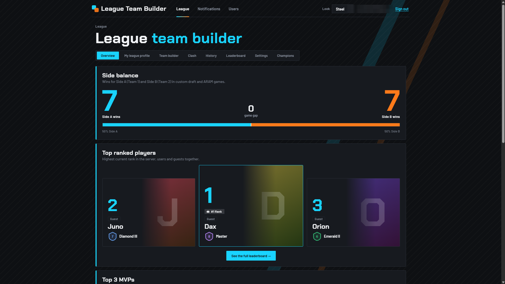
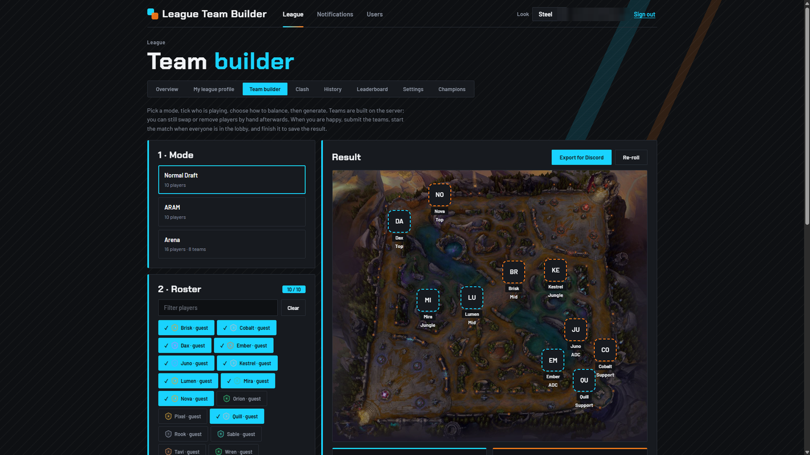
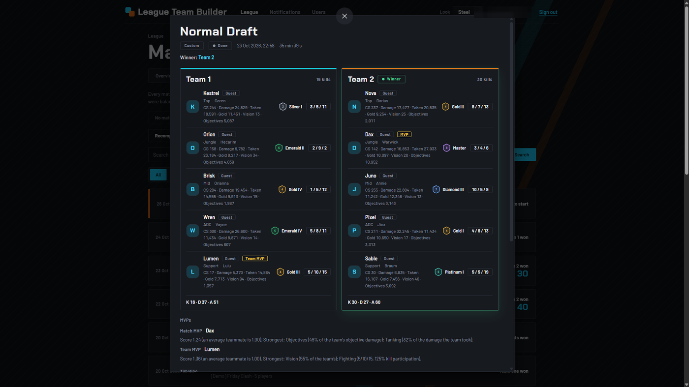
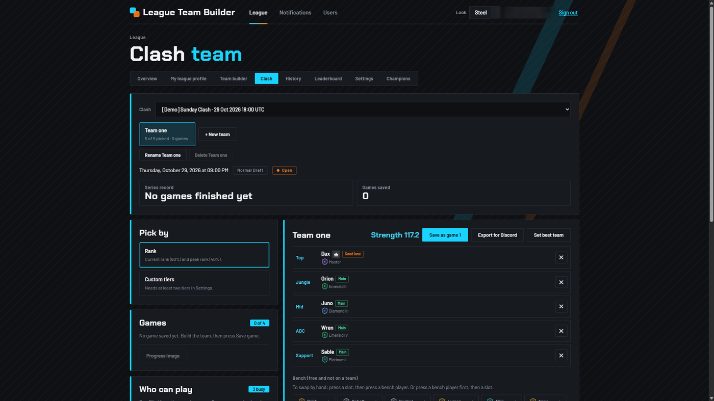
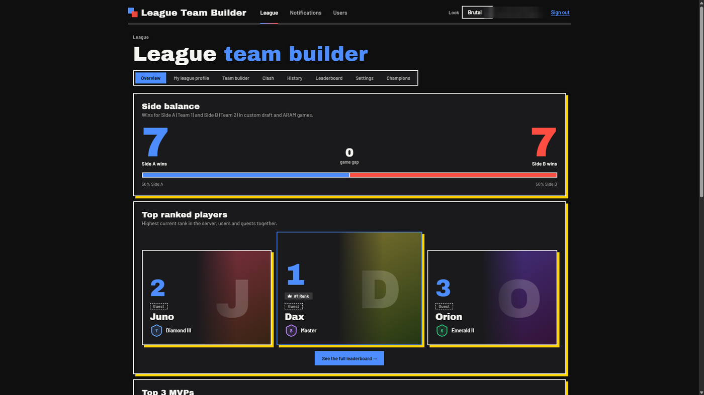
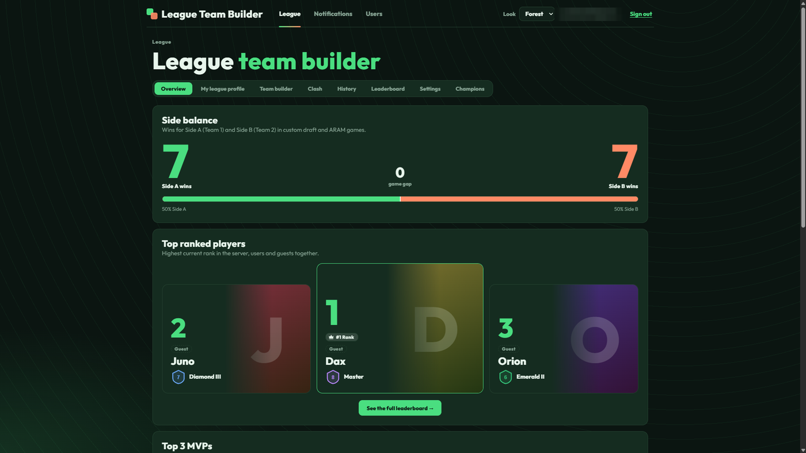

# League Team Builder

Build fair teams for League of Legends custom games, keep the history, and run your Clash roster, from one small website you host yourself.

> **Not endorsed by or affiliated with Riot Games.** League of Legends and Riot Games are trademarks of Riot Games, Inc. This is a fan-made community tool. It contains no Riot artwork: rank badges are neutral placeholders you can replace with your own pictures. Champion names are listed as plain text only.

**Status:** pre-release, heading for `v0.1.0`. The web edition is what this repository contains. A downloadable offline desktop edition is planned for later and does not exist yet.

## What it does

- **Team builder.** Pick 10 players (accounts and guests), then build teams in Normal, ARAM or Arena mode. Balance by lanes, by rank, by your own custom tiers, or at random. Drag players between slots, rebuild, and save the game.
- **Game history.** Start a game, finish it with a winner, add stats and an MVP, edit the result or the date. Filter and open any past game.
- **Leaderboard and player pages.** Podium, MVP counts, recent form, per-player stats, and a "side balance" scoreboard that shows whether Side A or Side B wins more.
- **Clash.** Schedule a Clash, notify members, let them answer free or busy, build the Clash team, and track the games.
- **Guests.** Players without an account, with their own lanes, champions and ranks. A guest can later be linked to an account.
- **Result pictures.** Make a picture of a game or a map to share. Optional Discord auto-send posts it to a channel when a game finishes.
- **Rank badges.** One uploadable picture per rank (PNG, JPEG or WebP, up to 1 MB), or keep the default shields.
- **Three looks.** Steel (default), Brutal and Forest. Each person picks their own from the top bar, and it is remembered.
- **Three roles.** Admin, Officer and Member (see below).

## Screenshots

<!-- These six images are not in the repository yet. Add them to docs/screenshots/ before the repository goes public (step D4). The shot list is in EXTRACTION-PLAN.md, section 9, D2. -->

| | |
|---|---|
|  |  |
|  |  |
|  |  |

## Run it

You need the [.NET 10 SDK](https://dotnet.microsoft.com/download) (the repository pins it in `global.json`). Nothing else: the database is a single SQLite file.

```bash
git clone https://github.com/<owner>/league-team-builder.git
cd league-team-builder/src/LeagueTeamBuilder

# The first Admin account. Stored outside the repository (user-secrets), never in a file you commit.
dotnet user-secrets set "Seed:AdminEmail" "you@example.com"
dotnet user-secrets set "Seed:AdminPassword" "choose-a-password"   # at least 8 characters

dotnet run
```

Open the address printed in the console and sign in with that e-mail and password. The database is created and upgraded by itself on start-up; you never run `dotnet ef`.

The Admin is only created when the site has no active Admin. Changing `Seed:AdminPassword` later does not change an existing password.

### Try it with demo data

Turn on the demo seed to see every page filled in:

```bash
dotnet user-secrets set "Demo:Seed" "true"
dotnet run
```

It adds 16 invented guest players, 14 finished games over three weeks (the newest has no stats on purpose, so you can try "Add stats"), one waiting game, a finished Clash and an upcoming Clash with answers. Everything is fake and marked as demo. The numbers are the same on every run. `Demo:Reset=true` removes the demo rows and adds them again; real players, games, accounts and settings are not touched. Both switches are off by default. The demo players are guests, so to try the Officer and Member views, use **Register** to make accounts and change their role in `/Admin/Users`.

## Run with Docker

You need Docker with Compose. From the repository root:

```bash
cp .env.example .env        # then edit .env: set SEED_ADMIN_EMAIL and SEED_ADMIN_PASSWORD
docker compose up --build
```

Open <http://localhost:8080> and sign in with that e-mail and password. Add `DEMO_SEED=true` to `.env` to start with demo data.

The database and the uploaded pictures live in one Docker volume mounted at `/data`, so they survive restarts and rebuilds. `docker compose down` keeps them; `docker compose down -v` deletes them. To back up, copy the volume's contents (the `.db` file with its `-wal` and `-shm` files, and the `uploads` folder) while the site is stopped.

Behind a reverse proxy that handles https, uncomment `ASPNETCORE_FORWARDEDHEADERS_ENABLED` in `docker-compose.yml`. Do not set it when people reach the container directly. Keep the database on a local disk or a Docker volume, not on a network share, because SQLite does not work reliably on one.

## Roles

New accounts are **Members**. An Admin changes roles in `/Admin/Users`.

| Role | Can do |
|---|---|
| **Member** | Look at the overview, leaderboard, players and history. Edit their own league profile. Answer Clash invitations. |
| **Officer** | Everything a Member can, plus: build teams, run and edit games, set the MVP, import stats, run the Clash board, make result pictures, manage guests, player ranks and tiers, and schedule Clashes. |
| **Admin** | Everything an Officer can, plus: champion catalog, modes and maps, custom tier list, Discord auto-send, rank badges, linked-guest history, and users and roles. |

Who may do what is one table in `src/LeagueTeamBuilder/Services/RolePermissions.cs`. An action that is not in the table is denied to everybody, and a test fails if someone adds an action and forgets it.

## Configuration

Set values in `appsettings.json`, with `dotnet user-secrets` while developing, or as environment variables on a host (use `__` for the colon: `Seed__AdminEmail`).

| Key | Default | Meaning |
|---|---|---|
| `Seed:AdminEmail`, `Seed:AdminPassword` | not set | Creates the first Admin when there is none. Keep them out of files you commit. |
| `Database:Path` | `App_Data/leagueteambuilder.db` | Where the SQLite file lives. A relative path is relative to the app folder. |
| `Database:MigrateOnStart` | `true` | Upgrade the database when the site starts. |
| `Site:Name` | `League Team Builder` | Name shown in result pictures and as the Discord sender name. |
| `Theme:DefaultLook` | `steel` | Look for visitors who have not picked one: `steel`, `brutal` or `forest`. |
| `Demo:Seed`, `Demo:Reset` | `false` | Demo data, see above. |

## Your data

Everything lives in two places: the SQLite file (`Database:Path`, plus its `-wal` and `-shm` files while the site runs) and the pictures people upload (`wwwroot/uploads/`). To back up or move the site, stop it and copy both. (In Docker both are inside `/data`, see above.) Sign-in keys are stored in the database, so people stay signed in across restarts. There is no sync between two installations.

Passwords are handled by ASP.NET Core Identity. The site sends no e-mail, so password reset by e-mail does nothing: an Admin sets a new password for a member who forgets theirs.

## Tests

```bash
dotnet test tests/LeagueTeamBuilder.Tests
```

The tests cover the role table and its filter, the look picker, game names, match-day rules, the team balancer, the champion catalog, rank badge uploads and the demo seed.

## Contributions

**This project does not accept contributions.** Pull requests will not be merged. The code is MIT licensed: fork it and change your own copy however you like.

## License

[MIT](LICENSE). The license covers this code only. It gives you no rights to Riot Games' names, logos or artwork.
